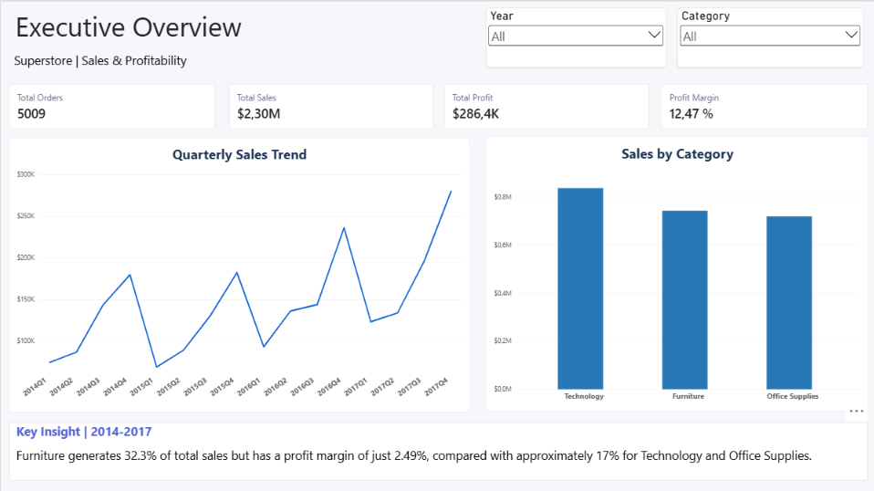
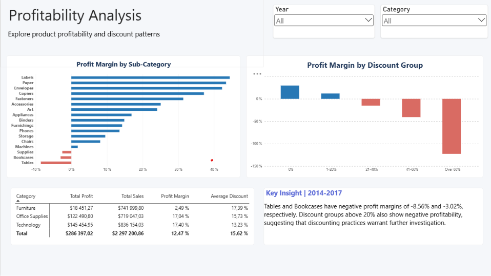

# Superstore Sales & Profitability Analysis | Power BI

A two-page Power BI report analysing sales performance and profitability in a sample retail business. The project focuses on answering practical business questions: **How are sales developing, which product categories contribute to profit, and where are discounts associated with losses?**

### Data Preparation and Modelling

The project uses the Superstore dataset from Kaggle, containing approximately 10,000 sales records. Data was prepared in Power Query by checking data quality and correcting data types.

A dimensional model was created with a central sales fact table and separate date, customer and product dimensions. DAX measures were used to calculate key metrics, including sales, profit, order count and profit margin.

## Report preview

### Executive Overview

### Profitability Analysis

## Key findings

- **$2.30M in sales** and **$286.4K in profit** across **5,009 orders** (2014–2017); overall profit margin: **12.47%**.
- **Furniture** accounts for approximately **32.3% of sales** but has a profit margin of just **2.49%**, compared with approximately **17%** in Technology and Office Supplies.
- Within Furniture, **Tables (−8.56%)** and **Bookcases (−3.02%)** have negative profit margins.
- Discount groups above **20%** show negative aggregate profit margins in this dataset. These are descriptive associations, not proof that discounts alone cause losses.

## Approach

- Prepared and transformed the dataset using **Power Query**.
- Organised the report data into a **fact table (`FactSales`)** and three related dimensions: **`DimDate`, `DimCustomer` and `DimProduct`**.
- Created **DAX measures** for Total Sales, Total Profit, Total Orders, Profit Margin and Average Discount.
- Designed two report pages with interactive **Year** and **Category** slicers, consistent KPI formatting, and concise business insights.

## KPI definitions

| KPI | Meaning |
| --- | --- |
| Total Sales | Sales revenue across the current filter context |
| Total Profit | Sum of profit across the current filter context |
| Total Orders | Distinct order count |
| Profit Margin | Total Profit / Total Sales |
| Average Discount | Average discount across sales rows |

## Files

- [`powerbi/Superstore_Analysis.pbix`](powerbi/Superstore_Analysis.pbix) — Power BI Desktop report and data model.
- [`screenshots/executive-overview.png`](screenshots/executive-overview.png) — First report page.
- [`screenshots/profitability-analysis.png`](screenshots/profitability-analysis.png) — Second report page.

To explore the interactive report, download and open the `.pbix` file in **Microsoft Power BI Desktop**. Refreshing the dataset may require updating the original local file path in Power Query.

## Data source

[Superstore Dataset — Vivek Chowdhury, Kaggle](https://www.kaggle.com/datasets/vivek468/superstore-dataset-final). The sample data covers 2014–2017 and is used here for learning and portfolio demonstration, not as evidence about an actual retailer. The original CSV is not distributed separately in this repository; the Power BI file contains an imported copy of the data.
